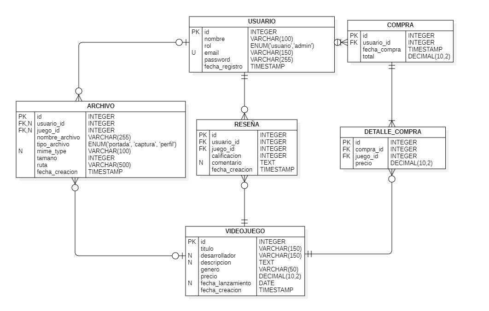

# Modelo de datos

## Diagrama Entidad-Relación

El siguiente diagrama representa las entidades principales de Gamix, sus atributos y las relaciones existentes entre ellas.

## Decisiones de diseño

- **USUARIO:** incluye el atributo `rol`, que permite diferenciar entre usuarios normales y administradores.
- **COMPRA y DETALLE_COMPRA:** permiten registrar las compras realizadas y los videojuegos incluidos en cada una, conservando el precio de cada videojuego al momento de la compra.
- **RESEÑA:** almacena las calificaciones y comentarios realizados por los usuarios sobre los videojuegos.
- **ARCHIVO:** almacena los metadatos de los archivos asociados a los usuarios o videojuegos, incluyendo el nombre, tipo, formato, tamaño y ruta del archivo.
- **Relación de ARCHIVO:** cada archivo debe estar asociado a un usuario o a un videojuego. Esta condición será validada desde el backend.
- **Persistencia de archivos:** los archivos físicos se almacenarán en el servidor, mientras que sus metadatos y rutas se registrarán en la base de datos.
